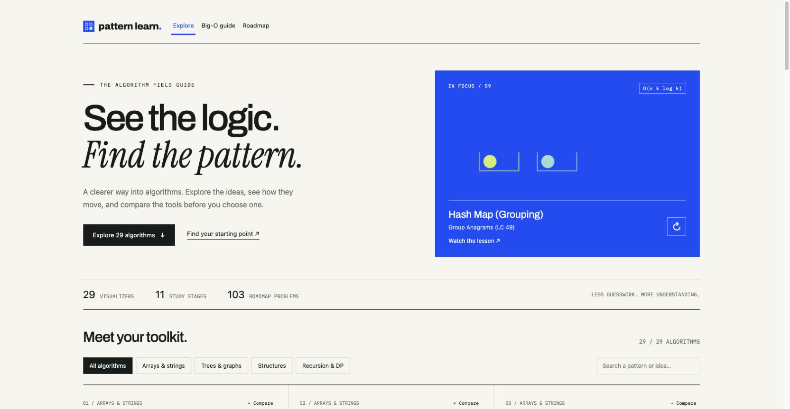
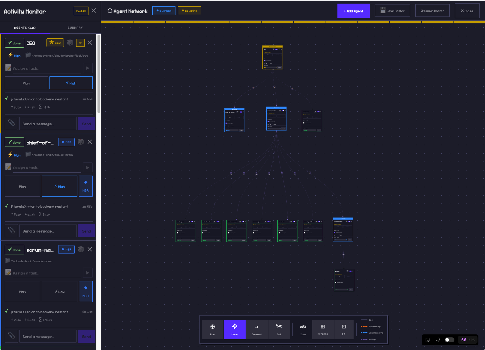
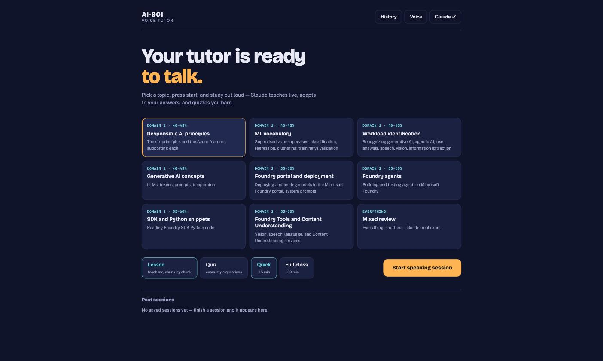

  <a href="https://patternlearn.com"><b>Try Pattern Learn</b></a> &nbsp; · &nbsp;
  <a href="https://apicad.github.io/"><b>Explore my portfolio</b></a> &nbsp; · &nbsp;
  <a href="https://www.linkedin.com/in/abdiel-picado/"><b>Connect on LinkedIn</b></a> &nbsp; · &nbsp;
  <a href="https://x.com/abdithenice"><b>Find me on X</b></a>

## Hey, I'm Abdiel 👋

A software engineer, curious builder, and programming educator from South San Francisco. I enjoy figuring out how things work, turning ideas into something you can click, and helping others build their first project.

My path has taken me from teaching Python and wiring Arduino projects with students to building marketing tools at LinkedIn. These days, I'm exploring interactive learning, AI agents, and useful automation. I like projects where I can connect the interface, the code, and the person using it.

- 🛠️ **Building:** Pattern Learn, agent workflows, and tools that simplify everyday work.
- 🌱 **Learning:** Computer science at Foothill College, one concept and experiment at a time.
- 💬 **Talk to me about:** web apps, AI prototypes, IoT, or making technical ideas easier to understand.

## My toolbox

 &nbsp;
 &nbsp;
 &nbsp;
 &nbsp;
 &nbsp;
 &nbsp;
 &nbsp;
 &nbsp;
 &nbsp;
 &nbsp;
 &nbsp;

Python · JavaScript · TypeScript · Java · C++ · HTML · CSS · React · Node.js · Git · Arduino

## Selected work

<table>
<tr>
<td width="50%" valign="top">

<h3>Pattern Learn</h3>

Explore algorithms through synchronized code, variables, and execution steps. Built with React and Vite, deployed on AWS with S3, CloudFront, and ACM.

<b>Live application</b> · <a href="https://patternlearn.com">Try it →</a>

</td>
<td width="50%" valign="top">

<h3>Multi-agent orchestration</h3>

A TypeScript and Node.js backend for spawning and messaging Claude Code agents, with HTTP, WebSocket, hook events, and transcript polling.

Built on <a href="https://github.com/pablodelucca/pixel-agents">Pixel Agents</a>. The original office interface is upstream work; my focus is the standalone backend and orchestration.

<b>Local application</b> · <a href="https://github.com/Apicad/AI-agent">Explore the code →</a>

</td>
</tr>
<tr>
<td width="50%" valign="top">
<h3>Job-application workflow</h3>

A Python pipeline connecting APIs and MCP tools with Gmail, Google Sheets, and a Flask dashboard. Posting-identity checks and local ledgers detect duplicates; generated application text is restricted to verified claims.

<b>Private project, in development</b> · Walkthrough available by arrangement.

</td>
<td width="50%" valign="top">

<h3>AI voice tutor</h3>

A React study app with spoken lessons, adaptive quizzes, voice input, and text-to-speech. Claude responses are validated before use, with scripted lessons available as a fallback.

<b>Local application</b> · <a href="https://github.com/Apicad/ai-voice-tutor">Explore the code →</a>

</td>
</tr>
</table>

## Let's connect

I'm open to software engineering and AI prototyping opportunities, and always happy to talk about what I'm building.

[LinkedIn](https://www.linkedin.com/in/abdiel-picado/) · [X / @abdithenice](https://x.com/abdithenice) · [Portfolio](https://apicad.github.io/)

Technology icons by <a href="https://github.com/devicons/devicon">Devicon</a>.
