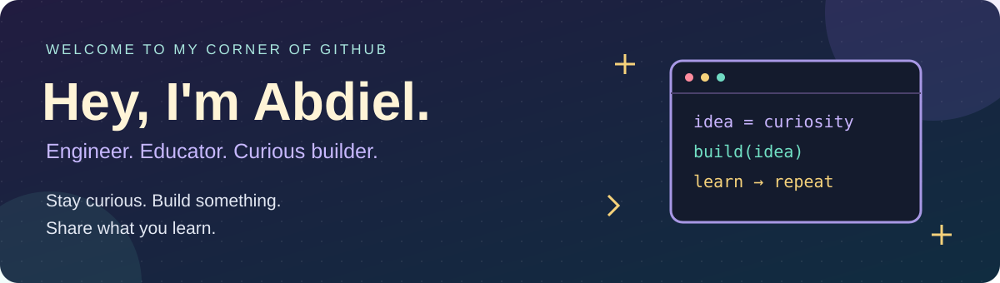
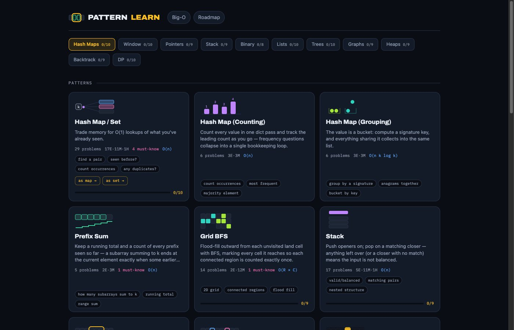

  <a href="https://patternlearn.com"><b>Try Pattern Learn</b></a> &nbsp; · &nbsp;
  <a href="https://apicad.github.io/"><b>Explore my portfolio</b></a> &nbsp; · &nbsp;
  <a href="https://www.linkedin.com/in/abdiel-picado/"><b>Connect on LinkedIn</b></a>

## Hi, I'm Abdiel

I'm a software engineer in South San Francisco building interactive web applications, AI prototypes, and Python automation. I like taking a workflow with too many manual steps and turning it into something people can understand and use.

At **LinkedIn**, I worked as a **GPO MarTech Intern**, delivering **18 tools and prototypes** across marketing technology, automation, and developer workflows. My work included a Node.js monitoring dashboard, API integrations, and Claude-powered campaign prototypes. Most of that work is internal; the projects below show what I'm building independently.

Before that, I wrote Python enrollment-processing scripts and taught programming as a **Program Assistant at CAM EDU**. At **Dev/Mission**, I guided students through hands-on IoT projects and helped troubleshoot their work. Teaching still shapes how I build: make the system understandable, give useful feedback, and help people see what happens next.

## Selected work

<table>
<tr>
<td width="50%" valign="top">

<h3>Pattern Learn</h3>

Explore algorithms through synchronized code, variables, and execution steps. Built with React and Vite, deployed on AWS with S3, CloudFront, and ACM.

<b>Live application</b> · <a href="https://patternlearn.com">Try it →</a>

</td>
<td width="50%" valign="top">

<h3>Multi-agent orchestration</h3>

A TypeScript and Node.js backend for spawning and messaging Claude Code agents, with HTTP, WebSocket, hook events, and transcript polling.

Built on <a href="https://github.com/pablodelucca/pixel-agents">Pixel Agents</a>. The original office interface is upstream work; my focus is the standalone backend and orchestration.

<b>Local application</b> · <a href="https://github.com/Apicad/AI-agent">Explore the code →</a>

</td>
</tr>
<tr>
<td width="50%" valign="top">
<h3>Job-application workflow</h3>

A Python pipeline connecting APIs and MCP tools with Gmail, Google Sheets, and a Flask dashboard. Posting-identity checks and local ledgers detect duplicates; generated application text is restricted to verified claims.

<b>Private project, in development</b> · Walkthrough available by arrangement.

</td>
<td width="50%" valign="top">

<h3>AI voice tutor</h3>

A React study app with spoken lessons, adaptive quizzes, voice input, and text-to-speech. Claude responses are validated before use, with scripted lessons available as a fallback.

<b>Local application</b> · <a href="https://github.com/Apicad/ai-voice-tutor">Explore the code →</a>

</td>
</tr>
</table>

## What I work with

| Area | Technologies |
| :--- | :--- |
| Languages | Python · TypeScript · JavaScript · SQL · HTML · CSS |
| Web applications | React · Node.js · Vite · Flask · SQLite |
| AI and integrations | Claude APIs · Claude Code · MCP · REST APIs · WebSocket · Zod |
| Deployment and testing | AWS S3 · CloudFront · ACM · Git · Playwright |
| Hardware and teaching | Arduino / C++ · micro:bit · Tinkercad · IoT projects |

## A little more about me

I'm studying computer science at Foothill College and building on experience across software development, technical support, and programming instruction. I'm especially interested in tools that make learning easier and AI workflows whose behavior people can inspect.

Open to software engineering and AI prototyping opportunities. The best place to reach me is [LinkedIn](https://www.linkedin.com/in/abdiel-picado/).
